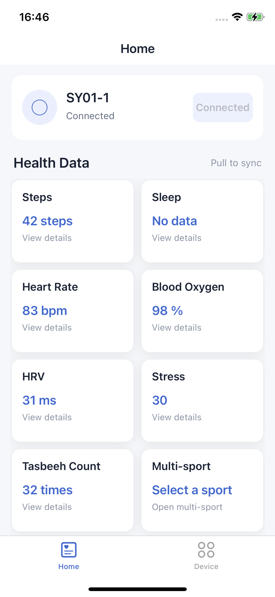
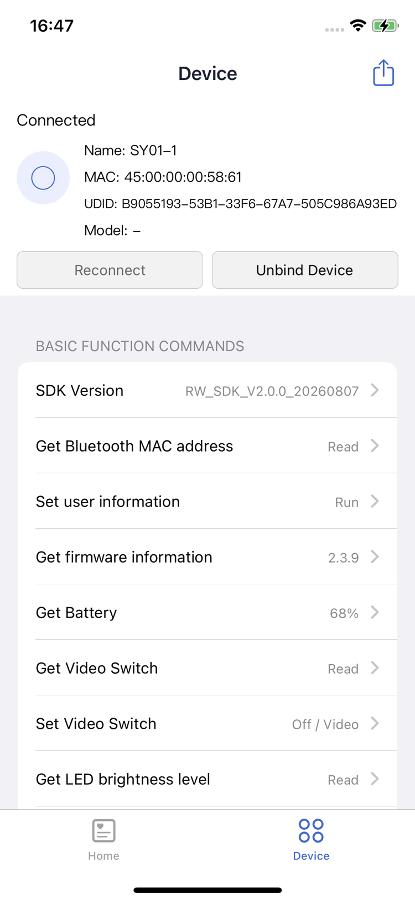

# RW iOS SDK

RWFit iOS BLE SDK — 用于智能戒指/手环设备的蓝牙通信开发套件。

RWFit iOS BLE SDK — Bluetooth communication SDK for smart ring/band devices.

## 文档 / Documentation

- [中文文档](doc/blesdkios_zh.md)
- [English Documentation](doc/blesdkios_en.md)

## SDK 版本选择 / SDK Variants

请选择以下一个 `DHBleSDK.xcframework`，不要同时引入多个版本。/ Choose one variant only.

| 版本 / Variant | 文件 / Framework | 新增依赖 / Additional dependencies |
| --- | --- | --- |
| basic | [DHBleSDK.xcframework](Frameworks/DHBleSDK.xcframework) | 无 / None |
| tl | [tl/DHBleSDK.xcframework](Frameworks/tl/DHBleSDK.xcframework) | [AB_FOTA.xcframework](Frameworks/tl/AB_FOTA.xcframework) |
| nordic | [nordic/DHBleSDK.xcframework](Frameworks/nordic/DHBleSDK.xcframework) | `iOSMcuManagerLibrary` (SPM 1.14.7) |
| tlNordic | [tlNordic/DHBleSDK.xcframework](Frameworks/tlNordic/DHBleSDK.xcframework) | 以上两项 / Both dependencies above |

各版本均保留原有 OTA 能力；按是否需要 TL / Nordic OTA 选择。SDK 设置为 **Do Not Embed**；`AB_FOTA` 设置为 **Embed & Sign**。完整依赖配置见集成文档。

All variants retain existing OTA support. Choose based on your TL / Nordic OTA needs. Set the SDK to **Do Not Embed** and `AB_FOTA` to **Embed & Sign**. See the integration documentation for setup details.

Demo 使用 **tlNordic**。打开 `RW_SDK_DEMO/DHBleSDKDemo.xcworkspace`，等待 SPM 依赖解析完成后运行。/ The Demo uses **tlNordic**. Open the workspace and allow SPM dependencies to resolve before running.

## Demo 展示 / Demo Preview

  
  

## License

[MIT License](LICENSE)
